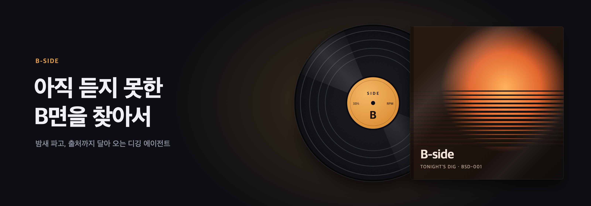
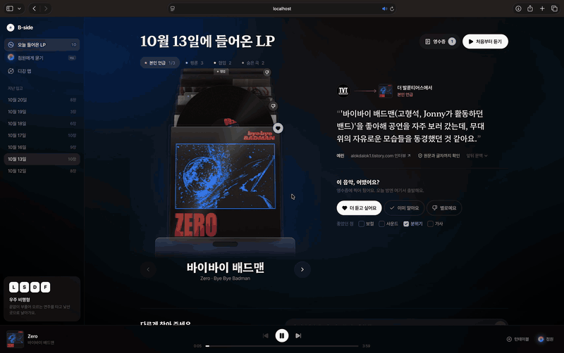
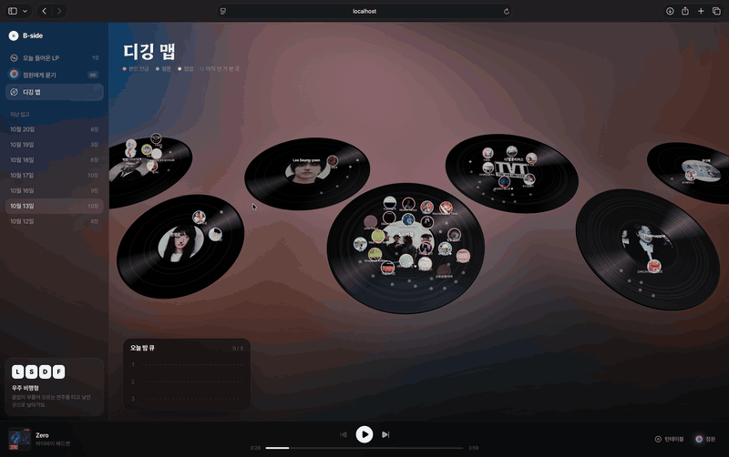
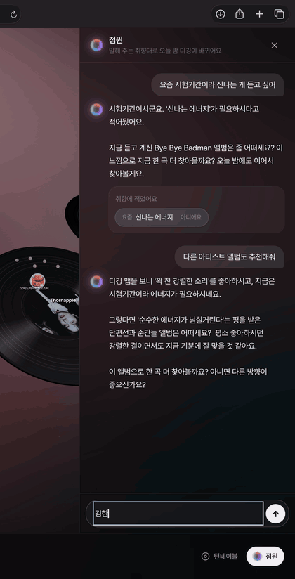
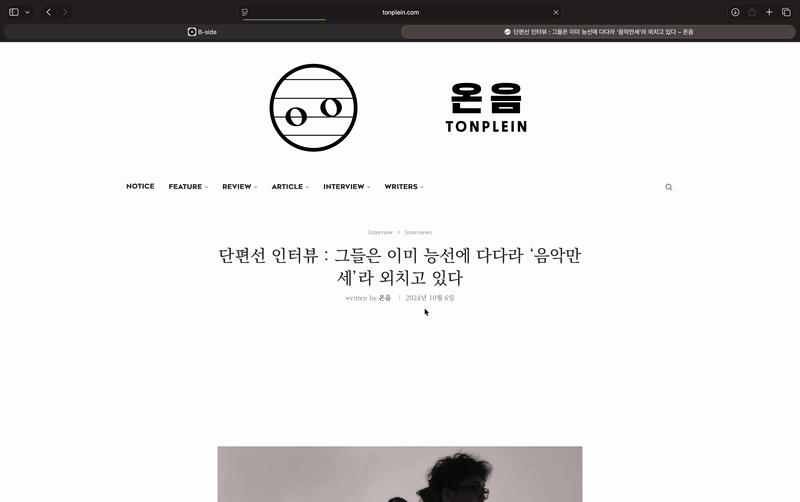
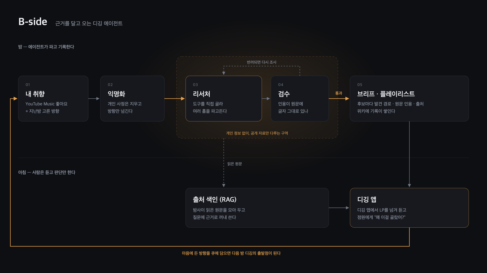

<p align="center">
  
</p>

<p align="center">
  <a href="https://jhwoo582.github.io/B-side/"><b>프로젝트 페이지</b></a> ·
  <a href="#2-아키텍처">아키텍처</a> ·
  <a href="#4-현재-결과">결과</a> ·
  <a href="#5-실행">실행</a>
</p>

<p align="center">
  
  
  
  
  
</p>

음악 디깅에서 귀찮은 두 가지, **정보 수집과 기록**을 에이전트가 밤사이 대신하고, 사람은 아침에 **듣고 판단만** 한다.
추천마다 발견 경로와 원문 인용이 붙고, 인용은 출처 원문과 글자 그대로 대조해 통과한 것만 내놓는다.

> 실전 AI 에이전트 시스템 설계·구축 (STS2022, 2026-2학기) MVP 보고서

### 데모

| 오늘 들어온 LP | 디깅 맵 |
|---|---|
|  |  |
| 추천마다 발견 경로, 원문 인용, 원문 대조 결과가 붙는다 | 시드 LP의 홈을 따라 발견한 음악과 다음에 팔 후보가 놓인다 |

| 점원은 기록에 없으면 지어내지 않는다 | 근거에서 출처 원문으로 |
|---|---|
|  |  |
| 기록에 없는 질문에는 “읽은 글에는 없다”고 답한다 | 인용이 나온 인터뷰 원문을 바로 확인할 수 있다 |

---

## 1. 문제

새 음악을 찾는 일은 "하나를 알게 되면 그 주변으로 파고드는" 반복 작업이다. 이 중 사람에게 정말 귀찮은 건 두 단계다.

- **수집:** 인터뷰·리뷰·크레딧을 여러 탭으로 열어 읽고, 영향원·협업 관계를 여러 홉 따라간다.
- **기록:** 어디서 발견했는지, 다음에 뭘 팔지 남긴다. 귀찮아서 대부분 안 하고, 그래서 다음 디깅이 처음부터 다시 시작된다.

기존 도구는 이걸 못 푼다.

| 기존 | 한계 |
|---|---|
| 스트리밍 추천 | 유사도 기반이라 "왜"가 없고 발견 경로가 남지 않는다 |
| MusicBrainz·Discogs 같은 DB | 연결 데이터는 있지만 직접 파고 직접 정리해야 한다 |
| 챗봇에 "추천해줘" | 근거 없는 추천(환각)이 섞이고, 세션이 끝나면 아무것도 남지 않는다 |

**목표:** 수집과 기록에 드는 사용자 노력을 줄이고, 후보마다 검증 가능한 원문 근거를 붙인다.
**비목표:** 취향을 예측해 정확한 추천 목록을 만드는 것, 듣기와 판단의 자동화.

### 성공 기준

| 기준 | 정의 |
|---|---|
| 근거 검증률 | 브리프에 실린 인용이 출처 원문과 글자 그대로 일치하는 비율. 목표 100% |
| 새로움·수락률 | 후보 중 "몰랐는데 들어볼 만하다"는 비율. 이미 아는 아티스트는 실패로 센다 |
| 사용자 노력 | 검증된 후보 1개를 얻는 데 드는 시간·조작 수. 직접 디깅보다 적어야 한다 |

수치 목표는 베이스라인(단발 LLM, 고정 RAG, 직접 디깅)을 측정한 뒤 정한다.

---

## 2. 아키텍처



### 추론: 생성과 검증의 분리

- **리서처**는 ReAct 루프로 도구를 직접 골라 시드에서 여러 홉을 확장한다. 경로가 중간 결과에 따라 바뀌므로 고정 파이프라인으로는 안 된다. 후보는 반드시 `발견 경로 + 원문 인용 + 출처 URL`을 붙여 제출한다.
- **검수**는 리서처와 독립적이다. 같은 모델에 "이유를 만들라"고 하면 추천을 먼저 정하고 이유를 지어내기 때문이다.
  - 1단계(코드, 결정론적): 출처 URL을 캐시 없이 다시 가져와 인용이 글자 그대로 있는지 대조한다. 공백·따옴표·유니코드 정규화만 허용한다. 실패하면 원문에서 가장 비슷한 문장을 돌려줘 리서처가 고쳐 내게 한다.
  - 2단계(판정 모델): 리서처의 설명이 아니라 원문 맥락만 보고, 인용이 주장한 연결(협업, 본인 발언, 평론가 비교 등)을 실제로 뒷받침하는지 판정한다.
- LLM은 리서처와 판정, 문장 작성에만 쓰고 시드 선정·새로움 확인·곡 선정·기록은 코드가 한다.

### RAG

- 리서처가 읽은 원문 페이지를 저장해 청크로 나눈다(약 3.5k 청크).
- 검색은 다국어 임베딩(multilingual-e5-large, 로컬 fastembed)과 한국어 문자 bigram BM25를 RRF로 결합한다. 아티스트 별칭 사전으로 이름 표기를 정규화한다.
- 점원 챗이 `search_sources` 도구로 이 색인을 검색해, "왜 이걸 골랐어?" 같은 질문에 저장된 원문을 인용해 답한다.
- 야간 실행이 끝나면 색인을 다시 만든다.

### 도구

| 도구 | 용도 |
|---|---|
| YouTube Music (ytmusicapi) | 청취 기록·좋아요 읽기, 아티스트 정보, 새 플레이리스트 생성 |
| MusicBrainz | 아티스트 관계·협업 크레딧 |
| Tavily | 웹 검색, 직접 요청이 막힌 페이지의 원문 추출 |
| 한국대중음악상 후보 데이터 | 같은 해·같은 부문 후보로 이어지는 평론 연결 |
| 인터뷰 언급 추출 | 인터뷰에서 아티스트 본인이 언급한 음악 |
| 새로움 확인 | 이미 아는 아티스트, 월 청취자 10만 초과 아티스트 거르기 |

### 모델

역할별 벤치(2026-10-14)로 골랐다. 전부 Hugging Face에 가중치가 공개된 오픈웨이트 모델이다. 지금은 OpenRouter의 ZDR(데이터 미보관) 제공자로 호출하고, 온프레미스 vLLM으로 옮기면 모델 이름만 바뀐다.

| 역할 | 모델 | 받는 데이터 |
|---|---|---|
| 리서처 | DeepSeek-V4-Pro | 공개 데이터 + 익명화된 방향만 |
| 점원·추천 이유·취향 노트·익명화·검수 판정 | Gemma-4-31B | 개인 데이터 (로컬 상정) |
| 문장 대조 확인 | Qwen3.6-35B-A3B | 생성된 문장과 원문 |

### 가드레일

- **개인 데이터 경계:** 리서처(상용 API) 호출 전에 반드시 익명화(`digger/anon.py`)를 거친다. 손님이 말한 개인 사정(학교·회사·건강·연애·장소·사람 이름)은 방향만 남기고 지운다.
- **쓰기 권한:** 스트리밍 계정에는 `Digging `으로 시작하는 새 플레이리스트 생성만 허용한다. 기존 플레이리스트와 라이브러리는 건드리지 않는다.
- **예산 상한:** 실행당 도구 호출 140회, 비용 $0.8, 시간 20분, 후보당 재시도 2회. 넘으면 중단한다.
- **감사 로그:** 모든 도구 호출, 모델 호출, 비용, 검수 결과를 JSONL로 남긴다. 실패는 조용히 넘기지 않고 알림을 띄운다.
- **웹 텍스트는 데이터로만:** 읽은 페이지 안의 지시문은 따르지 않는다.

---

## 3. 데모 시나리오

1. 매일 04:00 야간 배치가 돌아 새 아티스트 최대 8명과 아는 아티스트의 숨은 곡 2곡을 찾고, YouTube Music에 새 플레이리스트를 만든다.
2. 아침에 앱을 열면 밤사이 찾은 LP가 **디깅 맵**에 올라와 있다. 시드 LP 주변 홈을 따라 발견된 아티스트가 배치된다.
3. LP를 누르면 발견 경로(예: `Nilüfer Yanya —[협업]→ Wilma Archer`), 원문 인용과 출처, 곡 목록이 보인다.
4. 점원 챗(⌘K)에 "왜 이걸 골랐어?"라고 물으면 저장된 원문을 인용해 답한다.
5. 마음에 드는 방향을 **오늘 밤 큐**에 넣으면 다음 야간 디깅이 그 방향으로 이어진다.

---

## 4. 현재 결과

야간 실행 7회 (2026-10-12 ~ 10-20).

| 날짜 | 새 아티스트 | 숨은 곡 | 도구 호출 | 읽은 페이지 | 검수 반려 (글자 불일치) | 비용 | 시간 |
|---|---|---|---|---|---|---|---|
| 10-12 | 6 | 2 | 101 | 11 | 5 (2) | $0.20 | 8분 |
| 10-13 | 8 | 2 | 90 | 73 | 1 (0) | $0.28 | 14분 |
| 10-16 | 7 | 2 | 41 | 66 | 2 (0) | $0.12 | 25분 |
| 10-17 | 8 | 2 | 97 | 82 | 2 (0) | $0.29 | 26분 |
| 10-18 | 4 | 2 | 99 | 61 | 2 (0) | $0.45 | 17분 |
| 10-19 | 1 | 2 | 109 | 50 | 3 (0) | $0.49 | 15분 |
| 10-20 | 6 | 2 | 109 | 75 | 2 (0) | $0.78 | 13분 |

- 새 아티스트 40명을 찾았고, 브리프에 실린 인용은 모두 원문 글자 대조를 통과했다. 글자가 다른 인용 2건은 검수에서 걸러져 브리프에 실리지 않았다.
- 10-18, 10-19의 낮은 결과는 평론 후보 도구가 일부 아티스트 페이지 파싱 실패로 통째로 에러를 내던 버그 때문이었다. 실패한 아티스트만 건너뛰도록 고친 뒤 10-20 실행에서 6명으로 회복했다.

### 한계와 다음 단계

- **턴·비용 상한:** 최근 실행은 목표 8명을 채우기 전에 리서처 최대 턴(60)에서 멈춘다. 10-20 실행은 비용도 상한에 가까웠다($0.78 / $0.8).
- **유명 아티스트 유입:** 일부 예외 규칙으로 월 청취자가 많은 아티스트가 들어오는 경우가 있어 점검이 필요하다.
- **3-arm 비교:** 단발 LLM, 고정 RAG, 에이전트를 같은 과제로 비교해 "이 문제에 에이전트가 필요한가"를 검증한다. 차이가 없으면 그것도 결과로 보고한다.
- **사용자 노력 측정:** 직접 디깅과 비교해 검증된 후보 1개당 시간·조작 수를 잰다.

---

## 5. 실행

macOS, Python 3.14, Node 26 기준.

```bash
# 백엔드
python3 -m venv .venv
.venv/bin/pip install -r requirements.txt

# 키는 .secrets/ 폴더에 파일로 둔다 (저장소에는 올라가지 않는다)
mkdir -p .secrets
echo "<OpenRouter 키>" > .secrets/openrouter_api_key
echo "<Tavily 키>"     > .secrets/tavily_api_key
echo "<연락처 이메일>"  > .secrets/mb_contact          # MusicBrainz User-Agent용
.venv/bin/ytmusicapi browser --file .secrets/ytmusic_browser.json  # YouTube Music 브라우저 쿠키

.venv/bin/uvicorn app.api.main:app --port 8000

# 프론트엔드 (다른 터미널)
cd app/web-shop && npm install && npm run dev    # http://localhost:5174
```

```bash
# 디깅 한 번 돌리기
.venv/bin/python -m digger.pipeline               # 브리프·위키만
.venv/bin/python -m digger.pipeline --playlist    # 플레이리스트까지

# 매일 04:00 야간 배치 등록 / 해제
./scripts/install_nightly.sh
./scripts/install_nightly.sh --uninstall
```

개인 데이터(취향 지도, 브리프, 위키, 로그, RAG 원문)는 저장소에 없다. 처음 실행하면 청취 기록에서 새로 만들어진다.

---

## 6. 구조

```
digger/
  pipeline.py      야간 파이프라인: 시드 → 리서처 → 검수 → 작성 → 브리프·위키·플레이리스트
  researcher.py    ReAct 리서처와 도구 정의
  verifier.py      2단계 검수 (원문 글자 대조 + 판정 모델)
  writer.py        추천 이유 작성과 문장 확인
  rag.py           원문 색인과 하이브리드 검색
  chat.py          점원 챗
  anon.py          개인 데이터 익명화 경계
  frontier.py      다음에 팔 방향(오늘 밤 큐)
  wiki.py          개인 디깅 위키 기록
  audit.py         감사 로그
  bench*.py        역할별 모델 벤치
  sources/         YouTube Music · MusicBrainz · 웹 어댑터
app/
  api/main.py      FastAPI 서버
  web-shop/        웹 앱 (레코드 가게 UI, 디깅 맵)
  web/             이전 웹 앱
scripts/           야간 배치 실행·등록
data/kma_nominees.json  한국대중음악상 후보 데이터 (공개 정보)
```
